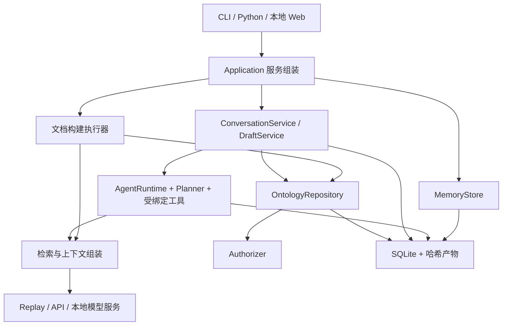

# 架构说明

本文描述当前源码实现。配置和数据字段见 [接口参考](reference.md)，未实现能力只列在 [路线图](../TODO.md)。

## 模块与调用关系

| 模块 | 主要源码 | 职责 |
| --- | --- | --- |
| Agent Runtime | `agent/runtime.py`、`agent/planner.py`、`agent/conversation.py` | 有界 plan/execute、工具选择、预算、恢复 |
| Context Engine | `retrieval/simple.py`、`context/template.py` | 候选选择、完整对象装包、字节预算 |
| Tool Management | `tools/registry.py`、`tools/invocation.py`、`tools/ontology.py` | 插件发现、资源绑定、参数/结果校验与调用限制 |
| Memory Service | `memory/store.py` | 显式经验保存、范围过滤、词法召回、删除 |
| State & Checkpoint | `state/store.py`、`conversations/store.py` | run、检查点、消息、草案、操作日志与回执 |
| Governance | `governance/`、`ontologies/`、`services/confirmation.py` | 权限、证据/结构校验、版本冲突、确认及审计 |

`Application` 读取可信工作区配置并组装这些服务。CLI、Web 和工具复用服务，不各自实现一套本体写入逻辑。基础包依赖标准库；Web、LangGraph、文档 loader、MinerU 分别可选。

## 三种执行链路

### 查询

正式查询使用 `answer → search → Repository.read → SimpleRetriever`，返回固定版本的本体记录和 ID 引用。查询本身是确定性检索；LLM 可以选择查询工具，但没有命中时不编造事实答案。

会话内 `draft_query` 查询本轮固定的草案快照，结果注明 draft_id/revision。正式 version 与草案 revision 是不同的身份，不混用。

### 文档构建

1. 检查 read/propose，固定基础版本，加载并登记资料，保存不可变文档和 chunk。
2. prepare：基础本体应用此前已接受操作，检索当前草案，保存 ContextPack 与请求。
3. model：调用模型并计量每次尝试，保存响应。
4. accept：精确锚定引文、对齐概念、生成操作，验证整个候选本体；通过才加入草案。
5. 逐片段保存进度，最终生成不可变 ChangeSet v1。可信调用方检查 diff/validate，再显式 commit。

无效片段不进入后续上下文，结束状态为 completed_with_errors；模型调用等执行失败则停止。正式版本在 commit 前不变。源文件在任务创建后发生变化，不影响已保存证据偏移。

### 对话构建

一个 Conversation 绑定主体、本体和一个活动 Draft；每条用户消息产生 Turn，关联一次有界 Agent run。完整会话长期保存，每轮运行独立；MemoryStore 不承担草案状态。

每轮最多应用一个原子 EditBatch，批内可包含多个有依赖的操作。成功生成新快照和幂等回执，失败不推进 head。名称/指代含糊时澄清，用户回答作为新消息保留；不会修改历史原文。

新增/修改的字段保存 `field_evidence`。删除和撤销保存 `instruction_refs`，不能把“删除鲸”当成新的领域事实。assistant/tool 历史可帮助理解，但不自动成为用户证据。记录级旧 evidence 作为 legacy 来源保留，字段的新支持不依赖旧聚合列表。

修改名称不更换 ID；关系端点或类型改变通过删旧边、加新边表达。删除概念默认 restrict，必须显式处理关联边。撤销恢复最近有效批次的 before 快照，并生成更大的 revision；连续撤销按栈处理，旧分支仍保留。

schema 扩展由 SchemaChangeService 管理：LLM 只调用 draft_propose_schema 提议增量定义，宿主拦截真实用户的明确答复，并绑定到当前提案和草案版本。同意后在事务内更新 schema_ref、revision、撤销栈、回执与审计；拒绝则保持 schema。不存在模型可调用的批准工具。原始构建需求保留为后续轮次的来源，批准消息只授权 schema 扩展。diff 和审阅包包含 schema 变更，仓库校验批准链，最终仍通过独立确认发布。本阶段只支持增加类型，schema 冲突的 rebase 保守拒绝。

正式提交后的下一次交互进入新 draft，撤销边界随之重置。新建本体用明确的 create 模式和空草案，首次确认才创建正式资源。显式 rebase 在最新正式版本上验证旧净操作，冲突时保留原草案，不自动合并。

## 上下文选择与预算

每轮重新组装输入，不依赖提供方记住之前的请求。来源包括本轮原文、领域 schema、输出契约、当前本体/草案的相关结构、必要的近期对话；文档构建还可显式召回长期经验。

### 简单检索

默认 keyword 使用 NFKC、casefold 和空白归一化；英文词项及中文双字匹配。得分为：名称/别名在 query 中出现加 10，名称/别名词项交集每项加 2，定义词项交集每项加 1；同分按 ID 排序。

- keyword：选最多 min(top_k,max_nodes) 个种子。
- none：不提供本体候选，仍保留共同 schema、任务和原文。
- all：将全部概念作为候选，仍受 max_nodes 和最终字节预算限制。
- hops=1：仅扩展直接连接种子的关系；不是多跳路径算法。

候选是局部子图，用概念/关系 ID 引用完整记录。默认 top_k=10、max_nodes=30、max_edges=40、hops=0。关系始终需要两个端点。

### 装包

ContextPack 先放固定规则、任务、schema、输出契约与本轮原文，随后尝试完整概念、关系及端点，最后加入历史/经验。每次按完整 messages 的规范 JSON 计算 UTF-8 字节数，不截断对象或证据文本。

默认上限 32,000 字节，token_count=None；这不是 tokenizer 或 Provider 总请求长度。输出 token 上限另行配置，调用方需为模型容量选择合适的输入/输出预算。必需部分本身超限时报 context_overflow；节点优先的贪心装包可能挤占关系空间。

会话取最近 4 条消息作为候选，每条最多 1,000 字符，再受默认 2,000 字节的低优先级历史块预算限制。澄清可携带明确关联的用户原文。完整历史仍保存在数据库；摘要不能作为精确证据。当前会话不自动召回 MemoryStore。

ContextPack 记录选中/舍弃 ID、输入字节、模板哈希、来源及检索得分，便于对照分析。学习式选择器尚未实现；新算法需保留端点闭合、来源和预算不变量。

## 草案、审阅与正式提交

ChangeSet 由固定基础版本和净操作生成，内容不可变；改变内容产生新 ID，不修改旧提案。v1 为追加/补充，v2 支持字段修改和删除，正文带 conversation_review 提交策略。

prepare_review 固定 draft_id/revision、基础版本、候选哈希、ChangeSet 哈希、完整差异和结构报告，保存 15 分钟有效的审阅包。传输适配器展示后调用 present；这不是批准。

入口只将独立用户确认关联到当前包。默认 Planner 没有 commit/approve 工具，知道 review_id 也不获得提交权。旧 CLI commit 对会话 v2 返回 confirmation_required。编辑、撤销、新消息、过期、版本或校验契约变化都会阻止旧确认。

确认前重新校验证据和候选，先发布哈希快照，再在同一个 SQLite 写事务中：检查归属/权限/版本和回执，推进正式 current，记录 commit，消费 review，关闭 draft，保存确认回执与审计。失败回滚元数据；已发布但未引用的文件可以作为孤立产物清理。

同 key 同内容返回原提交结果；两个草案基于同一正式版本提交时，后者拒绝覆盖。确认已完成后的重试查询既有回执，不再次发布。

## 持久化与恢复

SQLite schema 当前为 1。objects 按 kind 保存版本、提案、记忆和会话对象；runs/checkpoints/operations/events/audit 等保存执行状态。会话复用对象表，没有新增数据库迁移器。

哈希产物写入临时文件、fsync 后替换；读取时验证校验和。产物发布/复用更新 pin，清理在同一类 SQLite 写事务下跳过近期 pin，并沿引用保留数据。引用感知清理不等于全部数据 TTL。

Agent 状态机包含 plan/execute，可选 LangGraph 调用相同节点和应用检查点；没有使用 LangGraph 原生 checkpointer。终态工具返回业务结果，非终态工具只向下一步提供有限摘要，完整 payload 存为产物。

恢复固定配置、包/工具版本、来源和输入快照，保留累计调用预算和有效运行时长。等待用户和离线时间不计入有效执行时间。操作日志和业务幂等回执处理“副作用完成但 Agent 结果尚未保存”的窗口；会话可从编辑回执恢复终态结果。

非幂等外部工具结果未知时进入 waiting_review，核实后 resolve，不盲目重放。取消等待不能撤回已发送的模型请求，响应落盘前崩溃仍可能重复计费。

工作区 OS 锁限制活动执行器，SQLite revision 比较保护元数据；正式提交并发正确性依赖事务和版本检查。它不是分布式执行系统。

## 权限与扩展

资源动作是 read/propose/write。普通 Application 初始化时加载可信权限快照；会话服务在请求边界刷新。当前不提供远程认证、对象级 ACL、受限视图的保护闭包或不可信插件沙箱，详见 [安全说明](../SECURITY.md)。

新 Planner 提供稳定 fingerprint 和 AgentDecision；新 Tool 声明 effect、版本、超时和幂等性，内部仍执行领域授权。检索/上下文当前由服务直接实例化，替换算法需改组装入口，并非已有任意算法插件注册表。

旧 `prepare/extract` 及 `harness/runner.py` 保留兼容提取协议；它们不具备新 build/会话的完整版本和恢复语义。新的业务功能以 Application 服务为入口。
